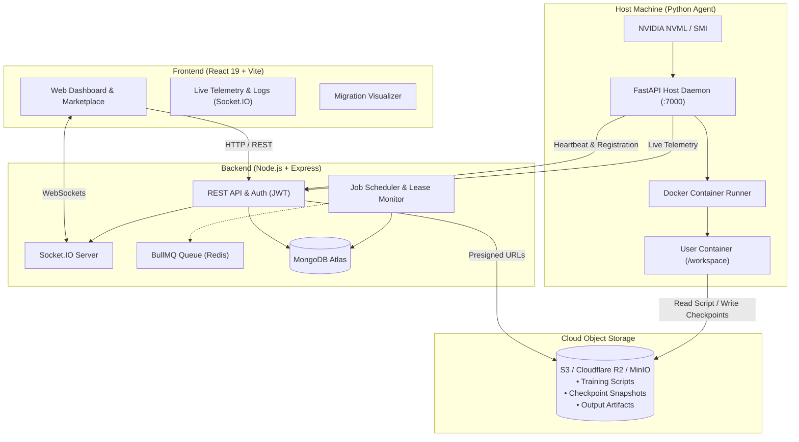

# ComputeGrid (Cloudforge) ⚡

> **Decentralized GPU Compute-Sharing Platform**  
> Monetize idle GPU hardware or rent high-performance compute on-demand for AI/ML training and inference.

---

## 📖 Overview

**ComputeGrid** is an end-to-end distributed compute marketplace connecting GPU owners (Hosts) with developers and researchers (Renters). 

- **Renters** can browse available GPUs, filter by VRAM and pricing, upload training scripts, and run containerized Docker workloads with live log streaming and hardware telemetry.
- **Hosts** run a lightweight Python daemon that advertises hardware specs via NVML, handles isolated Docker jobs, and supports **Instant Hardware Reclaim** through state checkpointing and automatic job migration.

---

## ✨ Key Features

- 🖥️ **GPU Marketplace**: Real-time listing of available nodes with dynamic filtering by VRAM, model, and hourly pricing.
- ⚡ **Lightweight Host Agent**: FastAPI-based daemon with NVIDIA NVML hardware detection, auto-registration, and heartbeat health checks.
- 🔄 **Checkpointing & Preemptive Reclaim**: Cooperative checkpointing snapshots container state to S3/R2 object storage every 60s. When a host reclaims their GPU, the job safely pauses and migrates to another compatible node.
- 📈 **Real-Time Telemetry & Log Streaming**: Socket.IO bi-directional streaming for live stdout/stderr logs and hardware health (temperature, utilization, power draw, fan speed, VRAM).
- 🗺️ **Job Migration Graph**: Interactive visualization tracking job migration stages (`Host A → Object Storage Checkpoint → Host B`).
- 🤖 **AI Models & Sandbox**: Built-in model registry and interactive prompt testing playground.
- 💳 **Integrated Billing**: Wallet balances, Razorpay payment gateway integration, demo credits, and automated job usage calculations.
- 🛡️ **Hardened Isolation**: Workloads run inside sandboxed Docker containers with mounted isolated workspaces and zero host filesystem access.

---

## 🏛️ Architecture



---

## 🛠️ Tech Stack

| Layer | Technologies |
| :--- | :--- |
| **Frontend** | React 19, Vite, Tailwind CSS v4, Framer Motion, Recharts, Lucide React, Socket.IO Client |
| **Backend** | Node.js (ESM), Express.js, MongoDB (Mongoose), Socket.IO, BullMQ, Redis (optional), AWS SDK S3, Razorpay, Zod, Winston |
| **Host Agent** | Python 3.11–3.13, FastAPI, Uvicorn, Docker Python SDK, NVIDIA Management Library (`pynvml`), psutil |
| **Storage** | AWS S3 / Cloudflare R2 / MinIO (presigned direct transfers) |

---

## 📂 Project Structure

```text
ComputeSharing/
├── agent/                  # Python GPU Host Daemon
│   ├── config.py           # Settings and environment loader
│   ├── docker_runner.py    # Container lifecycle & checkpoint sync
│   ├── gpu_info.py         # NVML / nvidia-smi telemetry extraction
│   ├── heartbeat.py        # Background registration & heartbeat thread
│   ├── main.py             # FastAPI entrypoint & scheduler
│   └── requirements.txt    # Python dependencies
├── backend/                # Node.js API & Orchestration Server
│   ├── controllers/        # Express route controllers
│   ├── models/             # Mongoose schemas (GPU, Job, User, Transaction)
│   ├── routers/            # Express endpoint routers
│   ├── utils/              # S3 storage, sockets, logger, BullMQ queue
│   ├── server.js           # Express app & HTTP/Socket server
│   └── package.json
├── frontend/               # React + Vite Web Application
│   ├── src/
│   │   ├── components/     # TelemetryPanel, MigrationGraph, Modals, Layout
│   │   ├── context/        # Auth and global state
│   │   ├── pages/          # Dashboard, Market, Host, Jobs, Billing, AI
│   │   └── App.jsx         # Routing & protected routes
│   └── package.json
└── .env.example            # Environment variables template
```

---

## 🚀 Getting Started

### Prerequisites

- **Node.js** (v18.x or v20.x+) and `npm`
- **Python** (3.11 – 3.13)
- **Docker** Desktop (Windows / macOS) or Docker Engine (Linux), running
- *(Optional for GPU acceleration)*: NVIDIA Driver + [NVIDIA Container Toolkit](https://docs.nvidia.com/datacenter/cloud-native/container-toolkit/latest/install-guide.html)
- **MongoDB** instance (Local or MongoDB Atlas)

---

### 1. Environment Configuration

Copy the example environment configuration into `.env` at the root:

```bash
cp .env.example .env
```

Ensure the key variables are configured:

```env
# Backend & Database
PORT=5000
FRONTEND_URL=http://localhost:5173
MONGO_URI=your_mongodb_connection_string
JWT_SECRET=your_long_random_jwt_secret
ENCRYPTION_KEY=your_16_byte_or_longer_encryption_key
ALLOW_LOOPBACK_AGENT_IPS=true

# Object Storage (S3 / R2 / MinIO)
OBJECT_STORAGE_BUCKET=your-bucket-name
OBJECT_STORAGE_REGION=us-east-1
OBJECT_STORAGE_ACCESS_KEY_ID=your-key
OBJECT_STORAGE_SECRET_ACCESS_KEY=your-secret

# Payment (Razorpay - optional for demo)
RAZORPAY_KEY_ID=your_key_id
RAZORPAY_KEY_SECRET=your_secret_key

# Frontend Config
VITE_API_URL=http://localhost:5000/api
```

---

### 2. Backend Setup

```bash
cd backend
npm install
npm run dev
```

*The backend runs on [http://localhost:5000](http://localhost:5000).*

---

### 3. Frontend Setup

In a new terminal:

```bash
cd frontend
npm install
npm run dev
```

*The web UI opens on [http://localhost:5173](http://localhost:5173).*

---

### 4. GPU Host Agent Setup

To register your local GPU or CPU machine as an available compute node:

```bash
cd agent
python -m venv .venv
```

**Activate virtual environment:**
- **Windows (PowerShell)**: `.\.venv\Scripts\Activate.ps1`
- **Linux / macOS**: `source .venv/bin/activate`

**Install dependencies:**
```bash
pip install -r requirements.txt
```

**Launch the Agent:**
1. Sign in to the frontend at [http://localhost:5173](http://localhost:5173) and go to the **Add GPU** page (`/host`).
2. Copy your **Personal Access Token**.
3. Run the agent with your token:
   ```bash
   python main.py --token <YOUR_COPIED_TOKEN>
   ```

*Once connected, your hardware specs will automatically appear on the dashboard with live telemetry gauges.*

---

## 🔄 Cooperative Checkpointing & Reclaim Protocol

ComputeGrid supports seamless workload resumption when a host needs their GPU back:

1. **State Preservation**: Workloads write snapshots to `/workspace/checkpoints` (`$CHECKPOINT_DIR`).
2. **Atomic Uploads**: The host agent archives and uploads snapshots to object storage every 60 seconds.
3. **Reclaim Trigger**: When the host clicks **Reclaim GPU**, the agent cleanly halts the container after the latest checkpoint upload.
4. **Resumption**: The job returns to the dispatch queue and resumes on the next compatible GPU host with `RESUME_FROM_CHECKPOINT=true`.
5. **Real-Time Progress**: Workloads report percentage completion to stdout using:
   ```text
   GPUSHARE_PROGRESS:{"step": 50, "total": 100, "message": "Epoch 5/10"}
   ```

---

## 🔒 Security Measures

- **No Public Open Ports Needed on Host**: Agents make outbound polling requests to the backend.
- **SSRF / IP Protection**: Restricts agent IP registration using `ALLOW_LOOPBACK_AGENT_IPS` and sanitizes loopback/metadata addresses.
- **Direct S3 Pre-signed Transfers**: Workload scripts and output artifacts transfer directly between client/agent and object storage without traversing through the web API server.
- **Isolated Containers**: Workloads run without root access to the host filesystem.

---

## 📄 License

This project is licensed under the [ISC License](LICENSE).

